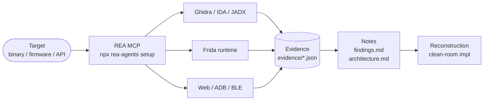

<div align="center">
  

  <a href="https://git.io/typing-svg">
    
  </a>

  <br/><br/>

  
  
  
  
  
</div>

---

A personal lab for structured reverse-engineering investigations driven by [REA](https://github.com/morluto/rea) — the MCP server that connects Claude Code to Ghidra, IDA, JADX, and runtime instrumentation. Each folder is a self-contained case: target artifacts, raw evidence, analysis notes, and clean-room reconstructions. Work spans embedded Linux firmware, native Go binaries, Cast protocol internals, vulnerability surface mapping, and JavaScript bundle archaeology.

> **Toolchain:** [REA](https://github.com/morluto/rea) · Ghidra 12 · Claude Code (Sonnet / Opus) · Python 3 · Frida

---

## Investigations

| Investigation | Target | Method | Key Finding | Status |
|---|---|---|---|---|
| [🔊 googlehomemini](./googlehomemini/) | Google Home Mini gen 1 — Marvell Armada 1500, fw `3.78.540761` | BLE setup API · Cast MITM · DNS injection · CVE-2021-30563 (Chrome/92 V8) · NAND tooling | No UART/JTAG on H0A; Cast registry MITM via AdGuard DNS rewrite unblocks `cast_shell` exploit chain | 🔬 Active |
| [🔒 tailscale](./tailscale/) | `tailscaled` + `tailscale` v1.104.1 (Arch pkg) | Go binary inspection · build provenance · dependency surface | Zero Arch patches — upstream v1.104.1 is an exact logic match; 71 Go modules mapped (wireguard-go, gvisor, TPM, WireGuard) | ✅ Baseline done |
| [👻 ghostcli](./ghostcli/) | GhostCLI API (`ghostcli.cloud`) | 28 JS bundle chunks · static analysis · live probes | 5 real models behind 7 advertised IDs; full alias map recovered; `z-ai/glm-5.3` vendor hidden | ✅ Report done |

---

## How it works



Each investigation follows the same layout:

```
<name>/
  target/       artifacts under investigation (binaries, firmware — not in git)
  evidence/     raw REA JSON output, one file per command
  notes/        findings.md · architecture.md · plan docs
  reconstruction/  clean-room implementation derived from notes
  scripts/      recon, analysis, and exploit tooling
```

---

## Quick start

```bash
git clone https://github.com/RemiPelloux/rea-lab
cd rea-lab

# Install REA + wire up to Claude Code
npx rea-agents setup

# Scaffold a new investigation
./new-rea.sh my-target

# Source REA env inside an investigation
source my-target/scripts/rea-env.sh
```

Then open Claude Code in the new folder and start with the `reverse-engineer-anything` skill.

---

## Adding an investigation

1. `./new-rea.sh <name>` — copies `_template/` with the right CLAUDE.md wired in.
2. Put artifacts in `<name>/target/` (never modified, never committed raw).
3. Use `scripts/ev.sh` to run REA commands and save results to `evidence/`.
4. Write conclusions in `notes/findings.md`, citing evidence files.
5. Open a PR — see the [investigation proposal template](.github/ISSUE_TEMPLATE/new-investigation.yml).

---

## Sponsor

If this work saves you time or sparks an idea, consider supporting it.

<div align="center">
  <a href="https://github.com/sponsors/RemiPelloux">
    
  </a>
  &nbsp;
  <a href="https://ko-fi.com/RemiPelloux">
    
  </a>
</div>

---

<div align="center">
  <sub>Built with <a href="https://github.com/morluto/rea">REA</a> · Driven by <a href="https://claude.ai/code">Claude Code</a> · MIT License</sub>
  <br/>
  
</div>
