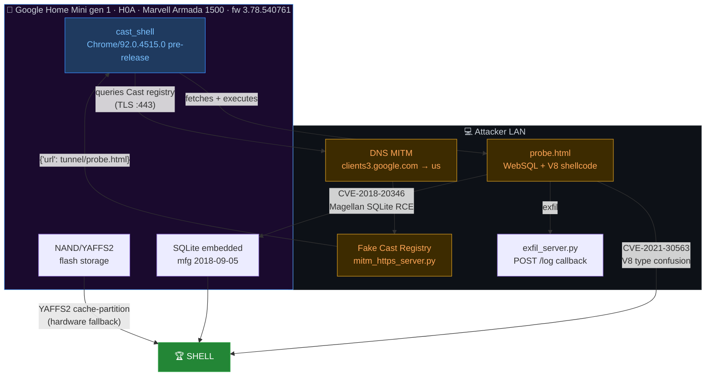
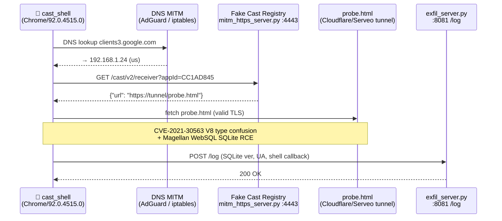

<div align="center">


<a href="https://git.io/typing-svg">
  
</a>

<br/><br/>

[](notes/findings.md)
[](notes/findings.md)
[](https://nvd.nist.gov/vuln/detail/CVE-2021-30563)
[](https://github.com/morluto/rea)
[](LICENSE)
[](https://github.com/RemiPelloux/HackoogleMini/stargazers)

</div>

---

**Software-only research project** to gain shell access to a Google Home Mini gen 1 (H0A) and replace its Google Assistant agent with a local LLM that can call arbitrary [MCP](https://modelcontextprotocol.io/) servers — zero hardware modifications. The device runs Chrome/92.0.4515.0 (a pre-release Chromium build that never received the [CVE-2021-30563](https://nvd.nist.gov/vuln/detail/CVE-2021-30563) V8 patch), making the Cast receiver a live exploit surface reachable via Cast registry DNS MITM. Toolchain: [REA](https://github.com/morluto/rea), Ghidra 12 headless, Python BLE/Cast scripts, Claude Code.

---

## Attack surface



## Status

| Area | State | Notes |
| --- | --- | --- |
| Device discovered | ✅ | `GoogleHome4983` — BLE + open setup AP, unprovisioned at start |
| Device identity | ✅ | `product_name: mushroom` — gen 1 H0A confirmed (findings E1) |
| BLE setup service | ✅ | 38 characteristics dumped without pairing |
| Setup API mapped | ✅ | `eureka_info`, `scan_results`, `scan_wifi`, `get_app_device_id`, `offer` |
| Device provisioned to LAN | ✅ | 192.168.1.29 · firmware 3.78.540761 · Chrome/92.0.4515.0 |
| Cast reachability | ✅ | port 8009 · Default Media Receiver CC1AD845 confirmed |
| **CVE-2021-30563 surface** | 🎯 | Chrome/92 pre-release — patch never shipped to this fw track |
| **Cast registry MITM** | 🔬 | DNS injection via AdGuard → fake registry → `cast_shell` loads probe |
| **Magellan (CVE-2018-20346)** | 🔄 | Mfg date 2018-09-05 → SQLite 3.26.0 not patched — re-evaluating |
| Firmware pipeline | ✅ | Verified end-to-end on synthetic image |
| NAND decode tooling | ✅ | `scripts/nand-decode.py` selftest green |
| UART / JTAG | ❌ | None on H0A (BGA pads) — NAND-only hardware path |
| Firmware image | ❌ | Blocking prerequisite for YAFFS2 path |
| **Shell access** | ⏳ | Active — DNS injection chain ready to execute |

**Short version:** Chrome/92 on the Cast receiver is unpatched for CVE-2021-30563. The attack chain is: DNS rewrite on AdGuard → `clients3.google.com` resolves to our MITM server → `cast_shell` fetches and executes our probe page → V8 exploit → shell. NAND + YAFFS2 is the hardware fallback.

---

## Attack chains

### Chain A — Chrome n-day via Cast registry MITM (active)



Scripts: `reconstruction/exploit/magellan/mitm_https_server.py` · `scripts/mitm-attack.sh`

### Chain B — Magellan SQLite RCE (revisiting)

Device manufactured **2018-09-05** (evidence E3). The [Magellan](https://lab.tencent.com/en-us/articles/zhuque-lab-en/magellan-web-sql-remote-code-execution-vulnerability-cve-2018-20346-cve-2018-20505-cve-2018-20506.html) vulnerability affects SQLite ≤ 3.26.0 — reachable from JavaScript via WebSQL in Chrome. The firmware shipped before the December 2018 disclosure; patch status in this fw build is under re-investigation.

Scripts: `reconstruction/exploit/magellan/probe.html` · `scripts/magellan-full.sh`

### Chain C — YAFFS2 cache-partition exploit (hardware)

The [published YAFFS2 exploit](https://ioactive.com/hacking-google-home-mini/) requires a NAND dump. No UART/JTAG on gen 1 H0A — board access means desoldering the NAND chip. Full toolchain is ready; blocked only on acquiring the dump.

Scripts: `scripts/nand-decode.py` · `scripts/fw-analyze.sh` · `scripts/ghidra-headless.sh`

---

## Quick start

```bash
# one-time setup
scripts/make-venv.sh

# LAN + BLE recon → evidence/
scripts/recon.sh

# join the Mini's open setup AP (while unprovisioned) + dump API
scripts/join-setup-ap.sh --api

# provision the Mini onto your network
scripts/provision-wifi.py --ssid <ssid> --pass <psk>

# set up lab AP: own the Mini's gateway (needs hostapd/dnsmasq + sudo)
scripts/lab-ap.sh up

# MITM: ARP spoof + DNS hijack + Cast LAUNCH (needs lab AP or DNS access)
scripts/mitm-attack.sh

# NAND tooling (once you have a dump)
scripts/nand-decode.py selftest
scripts/nand-decode.py layout target/<dump>.bin
```

`. scripts/rea-env.sh` first to call `rea` directly.

---

## Scripts

| Script | Purpose |
| --- | --- |
| `scripts/recon.sh` | LAN Cast + BLE scan → `evidence/` |
| `scripts/join-setup-ap.sh` | Join Mini's open AP, dump `eureka_info`, enumerate setup API |
| `scripts/setup_api.py` | Read-only GET enumeration of setup API surface |
| `scripts/provision-wifi.py` | POST `/setup/connect_wifi` — moves Mini onto network (destroys setup surface) |
| `scripts/lab-ap.sh` | Lab AP + DHCP + DNS logging + NAT + pcap |
| `scripts/mitm-attack.sh` | Full MITM: ARP spoof + DNS hijack + fake Cast registry + LAUNCH |
| `scripts/mitm-setup-root.sh` | iptables NAT rules (requires sudo) for MITM setup |
| `scripts/full-attack.sh` | End-to-end orchestration script |
| `scripts/magellan-full.sh` | Magellan SQLite RCE probe delivery pipeline |
| `scripts/probe-on-hotspot.sh` | Deliver probe page via direct hotspot (no network required) |
| `scripts/nand-decode.py` | NAND geometry/swap, partition extraction, string hunts |
| `scripts/cast_scan.py` | mDNS discovery + `eureka_info` dump |
| `scripts/cast_play.py` | List Cast devices / play audio URL on Mini |
| `scripts/ble_dump.py` | Full `0xfea0` dump: rotating address, canary-check, offset reads |
| `scripts/ble_scan.py` | BLE advertiser scan + GATT enumeration |
| `scripts/decode_gatt.py` | Inflate GATT payloads (gzip + partial inflate of 512-byte-capped) |
| `scripts/fw-analyze.sh` | REA firmware pipeline: identify → regions → extract → decompile |
| `scripts/ghidra-headless.sh` | Ghidra headless on ELF or raw ARM region |
| `scripts/find_kernel_sym.py` | Locate kernel symbols in raw ARM image |
| `scripts/fetch-ota-payload.sh` | Fetch OTA update payload from Google's servers |
| `scripts/ev.sh` | Run any `rea` command, save JSON → `evidence/` |

---

## Seven traps already solved

> Do not re-learn these.

1. **Rotating BLE address** — the Mini rotates its random address. Resolve by device name (`GoogleHome*`, service `0xfea0`) each run; never hard-code a MAC.
2. **Stale BlueZ handles** — `Connected: yes` on a stale handle returns empty reads. Canary-check the device-name characteristic (14 bytes) before trusting a dump.
3. **`busctl` decimal output** — `ay` byte arrays print in decimal, not hex. Parsing as hex corrupts every value.
4. **512-byte BLE cap** — three setup payloads are hard-capped at 512 bytes, notify is unsupported, and offset reads past 512 return nothing. `scripts/decode_gatt.py` partial-inflates the truncated prefix. The setup AP returns the full payload over HTTPS — use that instead.
5. **Silent Mini after failed attaches** — after repeated failed BLE connections the device can go silent for minutes. Power-cycle rather than assuming it vanished.
6. **No UART/JTAG on gen 1 H0A** — pads are under BGA, micro-USB is power-only. Board access = NAND desoldering.
7. **Magellan: check the ship date, not just the firmware version** — the fw version doesn't tell you which SQLite it links. The mfg date (2018-09-05) and the fw build date constrain the SQLite version more reliably than the fw string.

---

## Layout

```
target/         artifacts under investigation (not in git — large binaries)
evidence/       REA / firmware / recon output, one JSON file per command
notes/          findings.md · architecture.md · firmware-plan.md · ondevice-plan.md
reconstruction/ exploit code (clean-room — never copied from decompiled output)
  └── exploit/
      └── magellan/
          ├── probe.html          JavaScript probe: WebSQL/Magellan + CVE-2021-30563
          └── mitm_https_server.py  fake Cast registry + probe delivery over TLS
scripts/        recon + attack + analysis tooling (see table above)
work/           scratch: extracted regions, Ghidra projects (not in git)
```

---

## Read in this order

1. [`notes/ondevice-plan.md`](notes/ondevice-plan.md) — can the device run our code, what to replace, what it already speaks
2. [`notes/findings.md`](notes/findings.md) — observed evidence with links
3. [`notes/architecture.md`](notes/architecture.md) — what "replace the agent" means and the three options
4. [`notes/firmware-plan.md`](notes/firmware-plan.md) — how to get firmware and what to analyze

---

## References

- [IOActive — Hacking Google Home](https://ioactive.com/hacking-google-home-mini/) — YAFFS2 cache-partition exploit (hardware path)
- [Tencent Xuanwu — Magellan](https://lab.tencent.com/en-us/articles/zhuque-lab-en/magellan-web-sql-remote-code-execution-vulnerability-cve-2018-20346-cve-2018-20505-cve-2018-20506.html) — SQLite WebSQL RCE
- [CVE-2021-30563](https://nvd.nist.gov/vuln/detail/CVE-2021-30563) — Chrome V8 type confusion (Chrome/92 pre-release, unpatched on this fw)
- [Google Cast SDK](https://developers.google.com/cast) — Cast V2 protocol / CC1AD845 Default Media Receiver

---

<div align="center">

**[⚠️ Disclaimer](DISCLAIMER.md)** — educational security research only. Do not run against devices you do not own.

<br/>

<a href="https://github.com/sponsors/RemiPelloux">
  
</a>
&nbsp;
<a href="https://github.com/RemiPelloux/HackoogleMini/stargazers">
  
</a>

<br/><br/>


</div>
